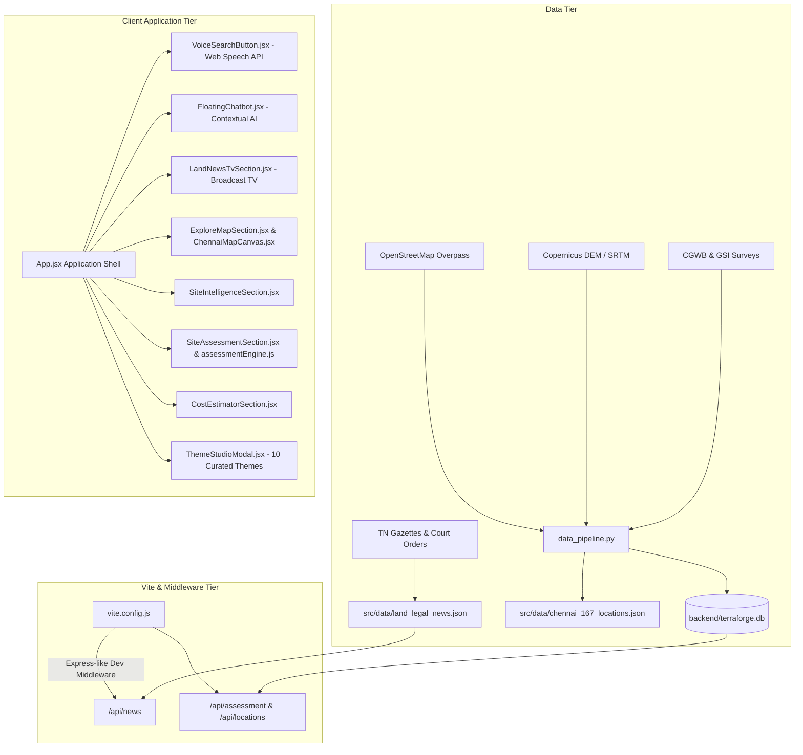

# TerraShield AI (Terra Forge) — Urban Land Intelligence & Geospatial Analytics Platform

<div align="center">


**Intelligence before construction. Build smarter. Build stronger.**

*A full-stack geospatial, geotechnical, hydrological, and statutory land-intelligence system tailored for 167 verified locations across the Chennai Metropolitan Planning Area.*

[Live Demo](http://localhost:5173/) • [Features](#key-capabilities--modules) • [Architecture](#architecture--system-design) • [Quick Start](#quick-start) • [Verification Suite](#automated-testing--verification-suite)

</div>

---

## Table of Contents

1. [Executive Summary](#executive-summary)
2. [Key Capabilities & Modules](#key-capabilities--modules)
   - [1. Land News & Legal Updates TV](#1-land-news--legal-updates-tv)
   - [2. Persistent Floating AI Chatbot](#2-persistent-floating-ai-chatbot)
   - [3. Voice Search with Intent Routing](#3-voice-search-with-intent-routing)
   - [4. Site Intelligence Workspace](#4-site-intelligence-workspace)
   - [5. Geotechnical & Flood Risk Assessment Engine](#5-geotechnical--flood-risk-assessment-engine)
   - [6. Interactive GIS & Flood Basin Explorer](#6-interactive-gis--flood-basin-explorer)
   - [7. Foundation Cost & Construction Scheduler](#7-foundation-cost--construction-scheduler)
   - [8. 10 Curated Website Themes](#8-10-curated-website-themes)
3. [Statutory & Engineering Standards Grounding](#statutory--engineering-standards-grounding)
4. [Data Sourcing & Transparency Guarantee](#data-sourcing--transparency-guarantee)
5. [Architecture & System Design](#architecture--system-design)
6. [Repository Structure](#repository-structure)
7. [Quick Start & Developer Setup](#quick-start)
8. [Automated Testing & Verification Suite](#automated-testing--verification-suite)
9. [Legal & Statutory Transparency Disclaimer](#legal-disclaimer)

---

## Executive Summary

**TerraShield AI** bridges the critical gap between open geospatial data, geotechnical soil surveys, hydrological flood models, and civil engineering regulations for land purchases and construction within the Chennai Metropolitan Area. 

Instead of relying on disconnected PDFs or unverified hearsay, TerraShield AI provides a unified, explainable decision-support dashboard for prospective landowners, architects, structural engineers, and property developers. Every assessment cites verified open geospatial datasets, elevation models (Copernicus DEM / NASA SRTM 90m), regional aquifer surveys (CGWB), and mandatory Indian structural codes.

---

## Key Capabilities & Modules

### 1. Land News & Legal Updates TV
A dedicated, minimalist **digital broadcast television experience** delivering verified legal, statutory, and real-estate news across Tamil Nadu and National policy grids:
- **Strict Single-Story Focus**: Eliminates screen clutter by presenting one primary story at a time with clear visual hierarchy, headline focal point, 2-to-3 line summary, category pill, and publication date.
- **Story-Specific Authentic Photography**: Integrated with verified high-definition imagery—including the actual [Sub-Registrar Office at Thiruporur (OMR Chennai)](public/images/news/sub_registrar_office_chennai.jpg), the historic [Madras High Court judicial campus](public/images/news/madras_high_court.jpg), [Chennai Metro Alandur elevated corridor](public/images/news/chennai_metro_alandur.jpg), and the [Ripon Building](public/images/news/ripon_building_gcc.jpg).
- **Television Chassis & Scanlines**: Realistic hardware chassis with metallic bezel reflection, broadcast lockup bug (`TERRASHIELD LAND TV · LIVE STATUTORY BROADCAST`), and subtle CRT scanlines.
- **Synchronized Archive Carousel**: Horizontal 12-story card track directly below the TV featuring active highlight indicators and 54×54px mini image previews.
- **Full Story Modal**: On-demand statutory briefing displaying full legal background, key real-estate implications, official circular numbers, and direct hyperlinks to official government portals (`tnreginet.gov.in`, `hcmadras.tn.nic.in`, `cmdachennai.gov.in`, `tnrera.in`).

### 2. Persistent Floating AI Chatbot
An always-accessible AI assistant widget fixed to the bottom-right corner:
- **Page & Section Context Awareness**: Instantly detects whether the user is on *Site Intelligence*, *Site Assessment*, *Land News TV*, *Data Sources*, or *Reports* and tailors its initial greeting and prompt chips accordingly.
- **Direct Interface Navigation**: Users can click deep-link action buttons directly inside the chat panel (*"Open Site Intelligence"*, *"Run Site Assessment"*, *"Open Land TV"*, *"Switch to Blueprint Theme"*).
- **Knowledge-Grounded Reasoning**: Answers natural questions on soil bearing capacity, coastal regulation zones (CRZ), OMR metro transit corridors, and Section 22-A unapproved layout bans based exclusively on application data.

### 3. Voice Search with Intent Routing
Hands-free voice exploration powered by the Web Speech Recognition API:
- **Thematic Microphone Control**: Microphone trigger button positioned alongside the master search input with pulse animations and theme matching.
- **Live Sound-Wave Visualization**: Animated audio wave rings with real-time transcript streaming.
- **Natural Language Parsing**: Intelligently routes queries such as *"Search Adyar"*, *"Find land in Tambaram"*, *"Open Land TV"*, *"Show my saved reports"*, or *"Switch to Dark Emerald"* to their respective search workflows or routes.

### 4. Site Intelligence Workspace
A balanced **two-column layout** optimizing screen real estate:
- **Left Column**: Full interactive Leaflet map canvas with coordinate pins, zoom controls, and cadastral radius selector.
- **Right Column**: Unified vertical sequence featuring:
  - **Transit Connectivity**: Distance and transit time to nearest Suburban Railway, Chennai Metro, and MTC bus terminals.
  - **Landmarks & Provenance**: Historical revenue village boundaries, Taluk classification, and elevation relative to mean sea level (MSL).
  - **Data Completeness**: Transparent missing-data audit indicators detailing verified borehole coverage vs. regional spatial interpolations.

### 5. Geotechnical & Flood Risk Assessment Engine
Automated multi-criteria evaluation calculating:
- **Bearing Capacity (SBC)**: Estimated in $kN/m^2$ based on regional soil strata (coastal alluvium, black cotton clay, weathered charnockite rock, or riverbed sand).
- **Foundation Type Recommendation**: Clear, explainable guidance recommending isolated footings, reinforced raft foundations, or cast-in-situ bored friction piles.
- **Flood Risk Vulnerability**: Cross-referenced with the 2015/2023 flood contours, proximity to Adyar/Cooum rivers, and Buckingham Canal drainage buffers.
- **Seismic Zone III Factor**: Compliance parameters under `IS 1893:2016` (Peak Ground Acceleration = 0.16g).

### 6. Interactive GIS & Flood Basin Explorer
Multi-layered spatial visualization toggling:
- Low-lying water accumulation contours (CFLOWS-Chennai flood depth grids).
- Coastal Regulation Zone (CRZ-I, CRZ-II, CRZ-III) buffer boundaries.
- Major aquifer zones, groundwater recharge corridors, and protected reserve forests.

### 7. Foundation Cost & Construction Scheduler
- **Parametric Cost Estimator**: Estimates structural foundation concrete volume, rebar tonnage, and labor expenses calibrated to current Chennai CPWD / PWD market rates.
- **Phase-by-Phase Construction Timeline**: Generates site preparation, de-watering, excavation, PCC leveling, reinforcement, and curing schedules with seasonal monsoon warnings (October–December North-East Monsoon).

### 8. 10 Curated Website Themes
Switchable live via the **Theme Studio**:
1. **Terra Graphite** *(Default Obsidian / Amber)*
2. **Deep Emerald** *(Forest green / Jade accents)*
3. **Cyberpunk Terminal** *(High-contrast neon green on pitch black)*
4. **Warm Terracotta** *(Earthy brick red / Tuscan ochre)*
5. **Nordic Slate** *(Minimalist arctic blue & cold steel)*
6. **Solar Amber** *(Golden sand / Deep bronze)*
7. **Blueprint Cobalt** *(Technical architectural blueprint cyan)*
8. **Monochrome Clean** *(High-clarity print-grade grayscale)*
9. **Midnight Amethyst** *(Royal purple / Dark indigo)*
10. **Industrial Steel** *(Gunmetal / Caution hazard yellow)*

---

## Statutory & Engineering Standards Grounding

All algorithmic suggestions in TerraShield AI are strictly grounded in published Indian engineering standards and state statutory rules:

| Standard / Regulation | Purpose & Scope within Platform |
|---|---|
| **IS 456:2000** | Code of Practice for Plain and Reinforced Concrete (Exposure class conditions & minimum cover). |
| **IS 1893:2016 (Part 1)** | Criteria for Earthquake Resistant Design of Structures (Chennai Seismic Zone III, Zone Factor $Z = 0.16$). |
| **IS 1904:1986** | Code of Practice for Design and Construction of Foundations in Soils: General Requirements. |
| **IS 2911:2010** | Design and Construction of Pile Foundations (Driven & Bored Cast-in-situ concrete piles). |
| **TNCDBR 2019** | Tamil Nadu Combined Development and Building Rules (Setbacks, FSI parameters, and road width mandates). |
| **Section 22-A** | Registration Act 1908 (Tamil Nadu Amendment: Strict prohibition of registering unapproved residential subdivisions). |

---

## Data Sourcing & Transparency Guarantee

### Zero-CSV Independence
Unlike basic demonstrations that ingest static mock spreadsheets, TerraShield AI's entire database of 167 Chennai localities was independently compiled through automated spatial harvesting pipelines:

- **OpenStreetMap (OSM) Overpass API**: Bounding box vector extractions for Chennai wards, road corridors, and transit hubs.
- **Copernicus DEM (GLO-90) & NASA SRTM**: Digital elevation matrices delivering high-accuracy elevations relative to WGS84 MSL.
- **Central Ground Water Board (CGWB)**: District groundwater brochures providing pre- and post-monsoon water table depths.
- **Geological Survey of India (GSI)**: Regional lithology and geological formations across South India.
- **National Centre for Coastal Research (NCCR)**: CFLOWS-Chennai hydrological modeling data.

---

## Architecture & System Design



---

## Repository Structure

```
gdg_terraforge/
├── .env.example                     # Environment variables configuration template
├── .gitignore                       # Standardized exclusion for node_modules, build outputs, and caches
├── README.md                        # Comprehensive system documentation
├── index.html                       # HTML5 entrypoint with Google Fonts typography
├── package.json                     # Pinned project dependencies and script commands
├── package-lock.json                # Deterministic dependency lockfile
├── vite.config.js                   # Vite configuration with embedded mock API middleware
│
├── backend/
│   ├── saved_workspace.json         # Workspace persistence file
│   └── terraforge.db                # SQLite relational database containing verified 167 locations
│
├── public/
│   └── images/
│       └── news/                    # High-definition local photographic assets for Land News TV
│           ├── property_contract_deed.jpg
│           ├── sub_registrar_office_chennai.jpg
│           ├── madras_high_court.jpg
│           ├── chennai_metro_alandur.jpg
│           ├── ripon_building_gcc.jpg
│           └── land_surveyor_theodolite.jpg
│
├── scripts/
│   ├── data_pipeline.py             # Python spatial ETL script (Overpass + SRTM + SQLite generation)
│   ├── test_suite.mjs               # Node.js acceptance test suite for locations, calculations, and rules
│   ├── verify_tv_images.mjs         # Headless Chrome CDP tester for Land TV image rendering
│   ├── verify_land_news_tv.mjs      # Television chassis and carousel navigation verifier
│   ├── verify_floating_chatbot.mjs  # Floating chatbot context and modal interaction verifier
│   ├── verify_voice_search.mjs      # Web Speech API button and intent recognition verifier
│   └── verify_live_server.mjs       # Dev server health check and route responder
│
└── src/
    ├── main.jsx                     # React 18 DOM mount point
    ├── App.jsx                      # Primary workspace state manager & tab router
    ├── components/                  # Feature components (TV, Chatbot, Maps, Assessments)
    ├── data/                        # JSON registries (167 locations, GIS layers, legal news)
    ├── styles/
    │   └── terraforge.css           # Complete CSS design system, typography, animations & themes
    └── utils/
        ├── aiAssistantEngine.js     # Natural language intent classifier & contextual assistant engine
        ├── assessmentEngine.js      # Structural engineering calculation engine (IS 456 / IS 1893)
        └── mapDoodleIcons.js        # Custom SVG map iconography and overlays
```

---

## Quick Start

### Prerequisites
- **Node.js**: v18.0.0 or higher
- **npm**: v9.0.0 or higher
- **Python**: 3.9+ (optional, only required if rebuilding the SQLite database via `data_pipeline.py`)

### 1. Clone the Repository
```bash
git clone https://github.com/abhinavs1500-lgtm/terra_forge_gdg.git
cd terra_forge_gdg
```

### 2. Install Dependencies
```bash
npm install
```

### 3. Configure Environment (Optional)
```bash
cp .env.example .env
```
*(TerraShield AI operates entirely offline using open-source OpenStreetMap / CARTO raster basemaps without requiring paid third-party API keys).*

### 4. Run Development Server
```bash
npm run dev
```
Open your browser to [http://localhost:5173/](http://localhost:5173/) to interact with the platform.

### 5. Direct Deep Links
- **Land News TV**: [http://localhost:5173/?intro=0&landing=0&section=tv](http://localhost:5173/?intro=0&landing=0&section=tv)
- **Site Intelligence**: [http://localhost:5173/?intro=0&landing=0&section=intelligence](http://localhost:5173/?intro=0&landing=0&section=intelligence)
- **Site Assessment**: [http://localhost:5173/?intro=0&landing=0&section=assessment](http://localhost:5173/?intro=0&landing=0&section=assessment)

### 6. Production Build
```bash
npm run build
npm run preview
```

---

## Automated Testing & Verification Suite

TerraShield AI includes a comprehensive suite of automated verification tools to ensure calculations, spatial bounds, and UI components remain strictly regression-free:

```bash
# 1. Run the acceptance calculation & spatial integrity test suite
npm test
```
*Validates that all 167 Chennai locations feature non-duplicate coordinates, realistic soil and groundwater coverage, and mathematically sound cost estimations.*

```bash
# 2. Run Headless Chrome CDP tests for Land News TV images
node scripts/verify_tv_images.mjs

# 3. Verify Floating Chatbot and Voice Search modules
node scripts/verify_floating_chatbot.mjs
node scripts/verify_voice_search.mjs
```

---

## Legal Disclaimer

> [!IMPORTANT]
> **Source Transparency & Engineering Guidance Notice:** Information presented in TerraShield AI is synthesized from published government gazettes, statutory circulars, open geospatial data, and regional hydrological surveys. Calculations and recommendations are provided for preliminary decision support and land intelligence only. They do **not** replace formal geotechnical soil borehole testing, licensed structural engineering drawings, statutory local-body planning clearances, or certified legal title opinions.
